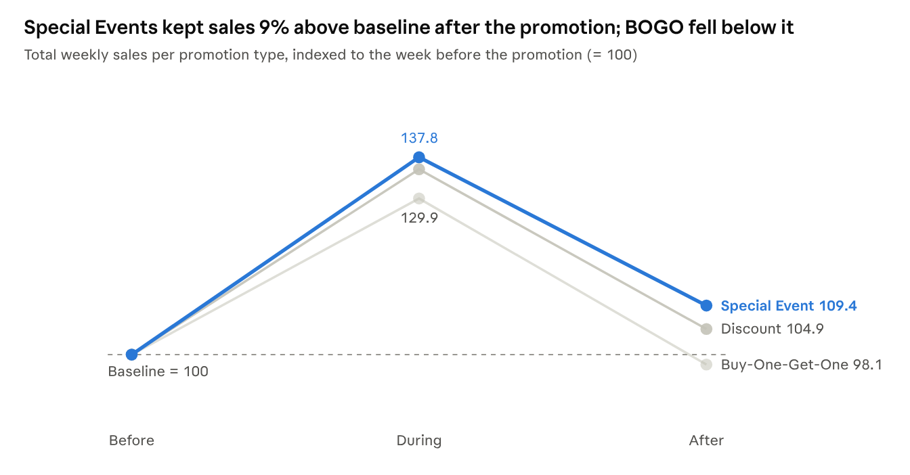
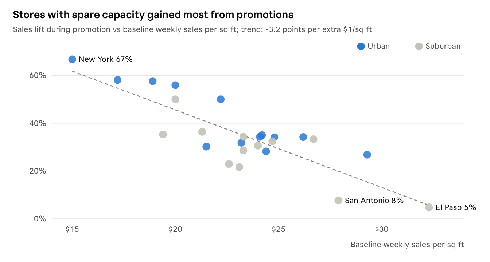
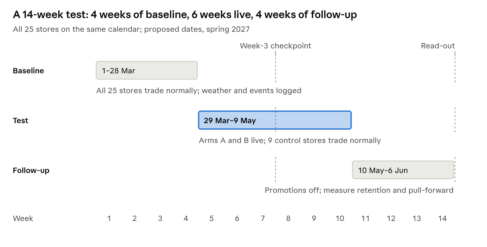

# GreenTrail Promotion Strategy Report

Nov 21, 2026 · @Nileesh

GreenTrail should retire Buy-One-Get-One, make community Special Events
its core promotion, and pair them with a trade-in and repair credit.
These should go first to stores with spare capacity. Then prove the plan
with a 14-week matched-store test: 8 stores per new format, 9 untreated
controls, 6 weeks live.

In the 2023 data, promotions lifted sales 34%, but only Special Events
kept customers coming back (+9% after, no store below baseline). BOGO
ended 2% below where it started. How busy a store already was predicted
lift far better than promotion type.

## Current promotion performance

The 2023 promotions lifted weekly sales by 34% (\$920K to \$1.24M across
25 stores, p \< 0.001), but only 4% of that lift survived once they
ended. What happens after the promotion is where the types differ most.

GreenTrail_Store_Data.xlsx · 25 stores, one promotion each, April–August
2023

| Promotion type  | Stores | Visits during (vs before) | Visits after (vs before) | Stores below baseline after |
|-----------------|--------|---------------------------|--------------------------|-----------------------------|
| Special Event   | 8      | +29%                      | +13%                     | 0 of 8                      |
| Discount        | 9      | +26%                      | +6%                      | 3 of 9                      |
| Buy-One-Get-One | 8      | +21%                      | +0%                      | 4 of 8                      |

By store type, urban stores lifted sales 40% and stayed 8% up
afterwards. Suburban stores lifted 27% and ended exactly at baseline.
The in-promotion differences between types are small and not
statistically significant (p = 0.54). The real separation shows up
afterwards (p = 0.056).

## Patterns and anomalies

The biggest driver of lift is not promotion type but how much spare
capacity a store had. A regression of lift on promotion type, store type
and baseline sales per sq ft explains 78% of the variation. Baseline
productivity alone carries most of it: each extra \$1 of weekly sales
per sq ft cuts lift by about 3 points (r = −0.83, p \< 0.001). Once
productivity is controlled for, promotion type adds nothing to the
in-promotion lift (p = 0.54).

GreenTrail_Store_Data.xlsx · baseline = weekly sales before promotion ÷
store size

- **Urban beats suburban.** Urban stores lifted 40% vs 27% for suburban
  (p = 0.016) and held +7.6% afterwards. Suburban stores returned
  exactly to baseline (index 100.0) with 5 of 12 dipping below it.

- **BOGO borrows from the future.** 4 of 8 BOGO stores sold less after
  the promotion than before it. Across the group, the post-period loss
  (−\$750/week per store) erases the gain. That is classic pull-forward:
  customers stock up, then stop buying.

- **Special Events build habits.** None of the 8 event stores fell below
  baseline afterwards, and visits stayed 13% higher. Events keep about a
  quarter of their lift. The post-period difference between promotion
  types is borderline significant (p = 0.056).

- **Traffic does most of the work.** Visits rose 26% on average while
  spend per visit rose about 8% (from ~\$14.7 to ~\$15.9). Promotions
  bring people in more than they change baskets.

- **Outliers worth a closer look.**

  - New York (Discount): +67% lift and +17% afterwards, from the lowest
    baseline productivity in the network (\$15/sq ft/week).

  - Philadelphia (Special Event): +58% during, +32% afterwards. The best
    lasting result in the data.

  - El Paso (BOGO, +5%) and San Antonio (Discount, +8%): the two most
    productive stores barely moved.

  - Los Angeles (BOGO): fell 14% below baseline afterwards, the worst
    hangover.

  - Chicago (Special Event): visits stayed 29% up afterwards but sales
    returned to baseline, so spend per visit fell to ~\$12.70.

**Limits of this data.** Every store ran a promotion, so there is no
untreated control. Each store ran only one type, so promotion type is
tangled with location and store size. Start dates run from 10 April to
29 August 2023, so seasonality is mixed into every comparison. Three
promotions ran 14 days and 22 ran 15. The length of the before and after
windows is not stated. There is no cost, discount depth or margin, so
profitability cannot be judged. Treat these results as signals to test,
not proof.

## Additional data to collect

The current file shows sales went up. It cannot show whether promotions
made money, who responded, or whether they fit GreenTrail's values. The
data below closes those gaps, highest priority first.

| Data                                                                                    | Why it matters                                                                                                          | Likely source             |
|-----------------------------------------------------------------------------------------|-------------------------------------------------------------------------------------------------------------------------|---------------------------|
| Promotion cost, discount depth, gross margin by SKU                                     | A 34% sales lift can still lose money on a deep discount. Needed to rank promotions on incremental profit, not revenue. | Finance, POS              |
| Daily or weekly sales for 8+ weeks before and after each promotion                      | Separates real lift from seasonality and week-to-week noise; shows how long effects last.                               | POS                       |
| Sales from non-promoted stores in the same weeks                                        | Gives the missing control group so trend and promotion can be pulled apart.                                             | POS                       |
| Transactions, units per basket, category mix                                            | Shows whether lift came from new trips, bigger baskets, or cheap add-ons.                                               | POS                       |
| Loyalty IDs: new vs returning customers, 90-day repeat rate                             | Tells acquisition from subsidy of existing buyers; measures lasting value.                                              | CRM / loyalty             |
| Customer demographics around each store (age, income, outdoor participation)            | Explains why urban stores respond more and lets offers be tailored by trade area.                                       | Census, loyalty profiles  |
| Regional economic indicators (unemployment, consumer confidence, fuel prices)           | Spending on discretionary gear moves with the local economy. Needed as a covariate.                                     | BLS, state data           |
| Competitor promotions and openings nearby                                               | A rival's sale can depress lift, or a closure can inflate it.                                                           | Field teams, ad tracking  |
| Returns and repairs after promotions                                                    | BOGO and deep discounts may raise returns and unused purchases.                                                         | POS returns               |
| Sustainability metrics: eco-line share, trade-ins, repairs, packaging, event attendance | Measures whether promotions move customers toward durable, low-impact choices.                                          | Store ops, event sign-ups |
| Online and app sales in each store's area                                               | Store promotions can cannibalise or lift online sales nearby.                                                           | E-commerce                |

## External factors

Outdoor retail is unusually exposed to weather and the calendar, so each
external factor needs a plan to measure it or neutralise it.

| Factor                                                 | How it can distort results                                                                                                               | How to control for it                                                                                    |
|--------------------------------------------------------|------------------------------------------------------------------------------------------------------------------------------------------|----------------------------------------------------------------------------------------------------------|
| Weather (temperature, rain, snow, smoke/air quality)   | A sunny weekend can lift hiking sales more than any promotion; a heatwave or wildfire smoke can suppress trips.                          | Add daily local weather as a covariate; run test and control stores in the same weeks and climate zones. |
| Season and holidays                                    | April–August spans the spring ramp, Memorial Day, July 4 and back-to-school. Promotions staggered across these dates are not comparable. | Run all test cells in one window; avoid holiday weeks or include them in every cell.                     |
| Local events (races, festivals, park openings, sports) | Can bring extra traffic regardless of the promotion. Also a chance: GreenTrail events can partner with them.                             | Keep a local events calendar per store; flag and model affected weeks.                                   |
| Regional economy                                       | Rising unemployment or fuel prices reduces trips and spending on gear.                                                                   | Use matched pairs within the same region; include economic covariates.                                   |
| Competitor activity                                    | A nearby sale cuts lift; a closure inflates it.                                                                                          | Record competitor events; exclude or flag affected stores.                                               |
| Media and brand campaigns                              | National ads or social campaigns overlapping the test lift every store.                                                                  | Freeze other campaigns in test regions or apply them equally to test and control.                        |

## Proposed promotional strategy

Shift spend from BOGO toward community events and circular-economy
offers, and aim them at stores with spare capacity. Events had the
strongest lasting effect in the data, and these offers reward durable
choices instead of extra consumption.

1.  **Retire Buy-One-Get-One.** It had the weakest lift (+30%), the only
    negative after-effect (−2%), and it encourages buying more than
    customers need. That conflicts with a sustainability brand.

2.  **Make Special Events the core format (test Arm A: "Trail Community
    Days").** Run repair and maintenance clinics, Leave No Trace and
    skills workshops, trail clean-ups with local parks groups, and
    used-gear swaps. These kept 25% of their lift and never fell below
    baseline. They also give customers a reason to return without a
    price cut.

3.  **Replace discounts with a Trade-in & Repair credit (test Arm B:
    "Event + ReGear").** Pair the event with store credit for trading in
    used gear (resold or recycled) or for a paid repair. Make the credit
    redeemable on certified durable or recycled-material lines within 30
    days. That drives a second visit and steers spend to the eco range.

4.  **Target by spare capacity, not by habit.** Lift falls about 3
    points for every extra \$1/sq ft of baseline weekly sales. Put
    promotional money first into lower-productivity stores (under
    ~\$23/sq ft/week, for example New York, Philadelphia, San Jose,
    Charlotte, Houston). In busy stores such as El Paso, San Antonio and
    Portland, use low-cost events and loyalty perks rather than price
    cuts.

5.  **Favour urban stores for paid offers; adapt suburban ones.** Urban
    stores lifted 13 points more. Suburban stores may respond better to
    family and weekend formats, such as kids' outdoor days or
    partnerships with local trail and sports clubs. Test this before
    scaling.

6.  **Keep any price discount shallow and eco-focused.** Where a
    discount is still needed, limit it to sustainable lines and
    end-of-season stock that would otherwise be cleared or wasted.
    Measure incremental margin, not only sales.

## Control strategy

Use a matched-store randomised test with a pre-period baseline: the
control stores run no promotion during the test, and every store is
measured against its own 4-week baseline (difference-in-differences).
This fixes the two weaknesses of the 2023 data: there were no untreated
stores, and dates were staggered across seasons.

- **Matching.** Stores are grouped into triplets within the same store
  type, sorted by baseline sales per sq ft, the strongest predictor of
  lift. Within each triplet, one store is randomly assigned to each
  cell. Portland, the odd store out, joins the control group.

- **Same weeks for everyone.** All 25 stores run baseline, test and
  follow-up in the same calendar weeks, so weather, holidays and the
  season hit every cell equally.

- **Effect = (test store change) − (control store change)** from
  baseline to test, estimated with store and week fixed effects, plus
  weather and local events as covariates.

- **Why not just "before vs after"?** In 2023, sales after promotions
  were 4% above the before-period across all stores. Part of that may be
  the spring-to-summer ramp, not the promotion. Only a concurrent
  control separates the two.

- **Contamination guard.** Pairs inside the same metro (Dallas and Fort
  Worth, for example) should not split between event and control if
  customers shop both. Swap within the triplet if needed. Keep national
  campaigns identical across cells.

- **Larger network.** If GreenTrail has stores beyond these 25, add the
  non-promoted ones as extra controls to raise statistical power.

The randomised assignment below (seed 2027) gives balanced cells: 8
stores in each test arm and 9 controls, each with 4–5 urban stores and
mean baseline productivity of \$22.3–\$23.7/sq ft/week.

| Store type | Triplet | Arm A: Trail Community Days | Arm B: Event + ReGear | Control      |
|------------|---------|-----------------------------|-----------------------|--------------|
| Urban      | 1       | San Jose                    | Philadelphia          | New York     |
| Urban      | 2       | Chicago                     | Phoenix               | San Diego    |
| Urban      | 3       | Memphis                     | Boston                | Detroit      |
| Urban      | 4       | Columbus                    | Denver                | Jacksonville |
| Urban      | 5       | —                           | —                     | Portland     |
| Suburban   | 1       | Charlotte                   | Houston               | Nashville    |
| Suburban   | 2       | Austin                      | Fort Worth            | Milwaukee    |
| Suburban   | 3       | Baltimore                   | Los Angeles           | Dallas       |
| Suburban   | 4       | El Paso                     | Louisville            | San Antonio  |

## Test duration

Run the promotions for 6 weeks, framed by a 4-week baseline and a 4-week
follow-up: 14 weeks in all, with a go/no-go checkpoint in week 3 of the
test.

Proposed test plan · dates are illustrative

- **Why longer than 2023's two weeks.** Two weeks capture the novelty
  spike but not what follows. Six weeks allow three events per store
  (one every two weeks) and show whether traffic holds after the first.

- **Room for the trade-in credit to work.** A 30-day redemption window
  needs at least four weeks inside the test plus follow-up, or the
  second visit it is designed to drive goes unmeasured.

- **Enough data to see a real difference.** Across stores,
  single-snapshot lift varied by ±15 points, so 8 stores per arm could
  only detect gaps of about 20 points. Six weekly readings against a
  4-week baseline cut that noise. Assuming about 8% week-to-week
  variation within a store, the test can detect differences of roughly
  7–10 points between an arm and control. Confirm this with weekly POS
  data before launch.

- **The follow-up is not optional.** The clearest 2023 finding was
  BOGO's post-promotion dip. Four weeks after the test ends are needed
  to catch pull-forward and confirm lasting lift.

- **Agile enough to act this season.** The week-3 checkpoint can stop an
  arm that is clearly losing. Results arrive in early June, in time to
  roll the winner out for the July–August peak.

- **Why spring.** March to June covers the spring ramp when outdoor
  demand is building, and avoids the summer peak and holiday sales.
  Easter and Memorial Day fall inside the window, but they hit every
  cell equally because all stores share the calendar.

## KPIs and decision rules

Scale an arm network-wide only if it beats control on profit and holds
its gains after the test, without hurting the sustainability measures.

| KPI                                                                    | Type           | Target to scale                                       |
|------------------------------------------------------------------------|----------------|-------------------------------------------------------|
| Incremental gross margin per store-week vs control                     | Primary        | Positive, with the 90% confidence interval above zero |
| Incremental weekly sales vs control (difference-in-differences)        | Primary        | At least +10%                                         |
| Follow-up index: sales in weeks 11–14 vs baseline, relative to control | Primary        | At least 100 (no pull-forward)                        |
| Daily visits and 90-day repeat rate (loyalty members)                  | Secondary      | Repeat rate up at least 3 points                      |
| Spend per visit and units per basket                                   | Secondary      | Not below control                                     |
| Share of sales from certified durable or recycled lines                | Sustainability | Up at least 5 points                                  |
| Items traded in, repaired, resold or recycled                          | Sustainability | Tracked per store; no target in the first test        |
| Return rate within 30 days                                             | Guardrail      | Not above control                                     |
| Event attendance and sign-ups to the community list                    | Engagement     | Tracked per event                                     |

- **Week-3 checkpoint.** Stop or adjust an arm early only for clear
  harm: sales more than 5% below control for two straight weeks, or
  operational problems such as stock-outs or low event turnout.

- **Read-out after week 14.** Report each arm against control for urban
  and suburban stores separately, and by baseline productivity, so the
  targeting rule in the strategy can be confirmed or dropped.

- **Next wave.** Roll the winner out to similar stores, keep a 20%
  holdout of stores as a standing control, and test the next idea (for
  example suburban family formats) the same way.
